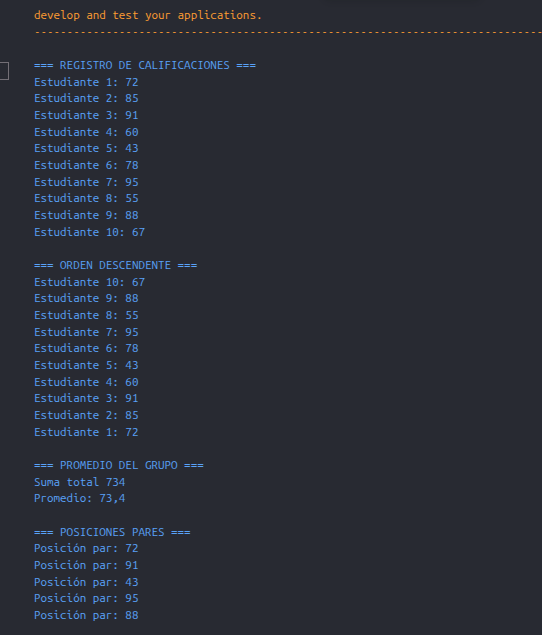
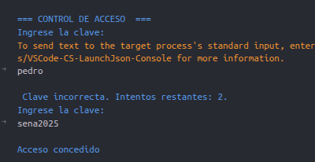
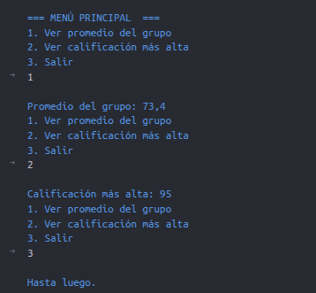
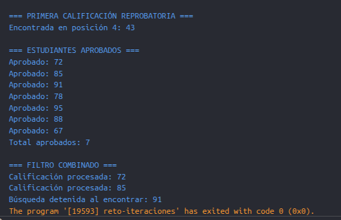

# 🚀 Reto: Estructuras de Control Iterativo en C#

Este repositorio recopila la solución a los ejercicios prácticos del reto de estructuras de control iterativo en C#, enfocados en el manejo de bucles (`for`, `foreach`, `while`), control de flujo con `break` y `continue`, y lógica algorítmica.

---

## 📌 Sección 1: Introducción a Bucles Básicos (For / While)
Esta sección se centra en el uso fundamental de los bucles iterativos para recorrer secuencias numéricas, realizar acumulaciones y calcular sumatorias o promedios de forma automatizada sin repetir código.

### Evidencia 1
> 

---

## 📌 Sección 2: Bucles Anidados y Validación de Datos
Aquí se implementan estructuras de control repetitivas anidadas (un bucle dentro de otro) y validaciones de entrada con bucles `do-while`, ideales para generar patrones visuales, matrices o menús interactivos robustos.

### Evidencia 2
> 
> 

---

## 📌 Sección 3: Break y Continue (Filtrado y Búsqueda Eficiente)
Se explora el control avanzado del flujo de ejecución mediante las sentencias `break` (para interrumpir bucles de manera anticipada al encontrar un objetivo) y `continue` (para omitir iteraciones específicas bajo ciertas condiciones), optimizando la búsqueda de datos en arrays.

### Evidencia 3
> 